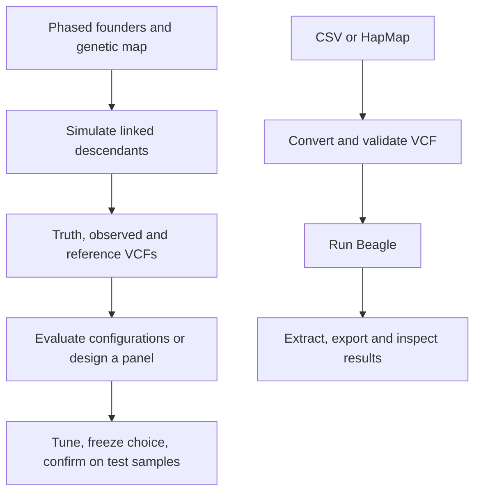

# Galick 

[](https://github.com/NDSU-AGDA/galick/blob/main/LICENSE.md)

**Genotype preparation, simulation and imputation evaluation in R.**

Galick supports plant- and animal-breeding genotype workflows: convert CSV and
HapMap to VCF, validate and repair records, run Beagle, and extract genotypes.
It also simulates linked descendants, compares Beagle configurations using
separate tuning and test samples, and designs smaller marker panels for
imputation of future individuals.

The package does not perform GWAS, estimate breeding values or guarantee that
better imputation improves trait prediction. Beagle remains the imputation
engine; Galick provides preparation, experiment design and inspectable results.

## Installation

Galick requires R 4.1 or later and is not yet on CRAN. The GitHub repository is
`NDSU-AGDA/galick`; the installed R package is **`galick`**.
The repository is public.

```r
install.packages("pak")
pak::pak("NDSU-AGDA/galick")
```

This installs the default branch. The package rename is complete.

Java 8+ and a Beagle 5 JAR are needed only for Beagle execution. With Java
installed, `galick::install_beagle()` downloads the pinned Beagle 5.4 build.
Other functions have their own tool requirements; see
[Installation](https://github.com/NDSU-AGDA/galick/blob/main/docs/getting-started/installation.md).

## Quick Start

This example uses bundled data and does not need Java or Beagle. The five-sample,
20-marker fixture demonstrates the API, not biological performance.

```r
library(galick)

csv <- system.file("extdata", "tiny.csv", package = "galick")
map <- system.file("extdata", "tiny_map.tsv", package = "galick")
vcf <- tempfile(fileext = ".vcf")

conversion <- csv_to_vcf(
  csv = csv,
  marker_map = map,
  output_vcf = vcf,
  encoding = "AHB"
)
stopifnot(conversion$ok)

validation <- validate_vcf(vcf, target = "beagle")
stopifnot(validation$ok)

counts <- vcf_to_dosage(vcf)
stopifnot(identical(dim(counts), c(5L, 20L)))
counts[1:3, 1:4]
```

`vcf_to_dosage()` counts ALT alleles from **GT**. It does not read expected
dosage from **DS**. Use `export_genotypes(..., format = "dosage", field = "DS")`
when expected dosage is required.

For an existing validated VCF, the Beagle step is:

```r
run <- run_beagle(
  gt = vcf,
  out = tempfile("phased_"),
  mode = "phase",
  nthreads = 1L,
  seed = 42L
)
stopifnot(identical(run$status, 0L))
calls <- vcf_to_hardcalls(run$output_paths[[1]], encoding = "012")
```

Check the returned status before reading output. Successful Beagle runs retain
commands, versions, input/output hashes and logs. Validation warnings are stored
in results; `$ok` means no collected errors, not proof of biological suitability.

## Three Experimental Workflows

| Function | Purpose | Main limitation |
|---|---|---|
| `simulate_vcf()` | Generate linked descendants from phased founders and a genetic map. | Realism depends on the founders and inheritance assumptions; no phenotype simulation. |
| `evaluate_imputation()` | Compare two to four Beagle configurations with separate tuning and test samples. | Trusted truth and deployment-appropriate holdouts are the user's responsibility. |
| `design_marker_panel()` | Select a fixed-size SNP panel, then independently test its imputation recovery. | A computational marker list is not a laboratory-ready assay or a trait predictor. |

These functions retain experiment records and can return a valid experiment
with **no recommended winner**. Inspect selection decisions, completion and
group metrics, not only `$ok`.



## Public API

28 functions, grouped by purpose:

| Area | Functions |
|---|---|
| Validation | `validate_genotype_table()`, `validate_marker_map()`, `validate_vcf()`, `validate_reference_match()` |
| Conversion | `csv_to_vcf()`, `hapmap_to_vcf()`, `vcf_to_dosage()`, `vcf_to_hardcalls()` |
| Export and merge | `export_genotypes()`, `merge_vcf()`, `detect_genotype_ploidy()`, `detect_subgenome_labels()` |
| Repair | `repair_vcf()` |
| Beagle | `run_beagle()`, `install_beagle()`, `beagle_version()` |
| Chromosomes | `split_vcf_by_chrom()`, `run_beagle_by_chrom()`, `merge_beagle_outputs()` |
| PLINK | `vcf_to_plink()`, `plink_to_vcf()` |
| Reporting | `imputation_report()` |
| Benchmarking | `mask_genotypes()`, `compare_imputed_vs_true()`, `benchmark_imputation()`, `evaluate_imputation()` |
| Simulation | `simulate_vcf()` |
| Panel design | `design_marker_panel()` |

## Documentation

- [Quick tour](https://github.com/NDSU-AGDA/galick/blob/main/docs/getting-started/quick-tour.md)
- [Reference](https://github.com/NDSU-AGDA/galick/blob/main/docs/reference/index.md)
- [Worked examples](https://github.com/NDSU-AGDA/galick/blob/main/docs/examples/index.md)
- [Migration to Galick](https://github.com/NDSU-AGDA/galick/blob/main/docs/getting-started/migration.md)

Installed tutorials are available through `browseVignettes("galick")`, including
`simulate-vcf`, `evaluate-imputation` and `design-marker-panel`.

## Scope and Status

Version 0.1.0 is being prepared for its first release. Validate representative data before
production use. VCF operations are primarily in-memory; workload limits are not
total-memory guarantees. Beagle workflows and imputation evaluation are diploid.
The simulator additionally supports restricted random-bivalent autotetraploid
inheritance; this does not enable polyploid Beagle imputation.

## Citation and License

Use `citation("galick")` for the current authors and version. Cite Beagle and any
other external methods used in your analysis separately.

Galick is MIT licensed; see [LICENSE.md](https://github.com/NDSU-AGDA/galick/blob/main/LICENSE.md).
External tools and R dependencies retain their own licenses. Report problems
through [GitHub issues](https://github.com/NDSU-AGDA/galick/issues).
