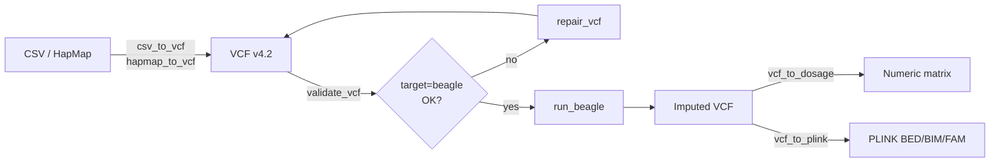

# beagler <a href="https://didiermurillof.github.io/beagleR/"></a>

<!-- badges: start -->
[](https://github.com/DidierMurilloF/beagleR/actions/workflows/R-CMD-check.yaml)
[](https://github.com/DidierMurilloF/beagleR/actions/workflows/lint.yaml)
[](https://lifecycle.r-lib.org/articles/stages.html#experimental)
[](LICENSE.md)
[](https://didiermurillof.github.io/beagleR/)
<!-- badges: end -->

> Genotype validation, conversion, repair, and Beagle imputation workflows
> for plant- and animal-breeding pipelines — pure R, with Beagle and PLINK
> shelled out as external tools.

beagler turns the messy front end of a breeding genotype pipeline (CSVs from arrays, TASSEL HapMap exports, hand-edited spreadsheets) into clean VCF v4.2 ready for [Beagle 5](https://faculty.washington.edu/browning/beagle/beagle.html) imputation — and pulls the results back into R as dosage or hard-call matrices. Every step has strict validation, a tolerant parser, classed errors you can dispatch on, and a JSON audit record with SHA-256 hashes.

It deliberately stays out of downstream analysis. GRMs, GWAS, mixed models, and breeding-value estimation are someone else's job.

## Why beagler?

- 🛡️ **Inspectable validation.** Issues are aggregated into a `beagler_result`. Programmer mistakes raise immediately; data issues come back as `$errors`. Repairs report record removals explicitly.
- 📜 **Real audit trail.** Every Beagle run emits a v1.0.0 JSON record with input/output SHA-256s, the full argv, and tool versions — what regulatory and IP-conscious breeding programs actually need.
- 🔁 **Resumable chromosome workflows.** When chromosome 7 fails three hours into a million-marker run, only chromosome 7 re-runs. Hash-checked resume guards against silent data churn.
- 🧬 **Honest with the format.** Seven encodings (`AHB`, `012`, `centered`, `AABB`, `VCF`, `REFHET`, `IUPAC`), TASSEL HapMap support with proper IUPAC decoding, BGZF input, chromosome-style normalization (`chr1` ↔ `1`).

## Install

```r
# pak (recommended)
pak::pak("DidierMurilloF/beagleR")

# remotes
remotes::install_github("DidierMurilloF/beagleR")
```

R >= 4.1 is required. You'll also need Java ≥ 8 and the Beagle JAR. Fastest setup:

```r
library(beagler)

install_beagle()      # downloads pinned Beagle 5.4 to user cache
beagle_version()
#> [1] "5.4"
```

The full [installation guide](https://didiermurillof.github.io/beagleR/getting-started/installation/) covers Java, Beagle, and the optional `bcftools` / `tabix` / `plink` toolchain.

## 30-second tour

```r
library(beagler)

# 1. Convert a breeder CSV to VCF
csv_to_vcf(
  csv        = "genotypes.csv",
  marker_map = "markers.tsv",
  output_vcf = "data.vcf"
)

# 2. Validate against Beagle's requirements; repair if needed
v <- validate_vcf("data.vcf", target = "beagle")
input_vcf <- "data.vcf"
if (!v$ok) {
  repaired <- repair_vcf(input_vcf, "data.clean.vcf")
  stopifnot(repaired$ok)
  input_vcf <- repaired$summary$output_path
  stopifnot(validate_vcf(input_vcf, target = "beagle")$ok)
}

# 3. Run Beagle (Java + JAR auto-discovered)
run <- run_beagle(
  gt       = input_vcf,
  out      = "imputed",
  mode     = "impute",
  nthreads = 4L
)

# 4. Pull results back into R
stopifnot(run$status == 0L)
dosage <- vcf_to_dosage("imputed.vcf.gz")
hard   <- vcf_to_hardcalls("imputed.vcf.gz", encoding = "012")
```

## The pipeline



## What's in v0.1.0

The package also includes loss-aware genotype export and general VCF merge
workflows:

```r
# Lossless export keeps phase and arbitrary ploidy
export_genotypes("calls.vcf", "calls.export.vcf", format = "vcf")

# HapMap cannot retain arbitrary ploidy or phase; losses are reported
export_genotypes("calls.vcf", "calls.hmp.txt", format = "hapmap")

# Merge the same marker set across different samples
merge_vcf(
  c("cohort_a.vcf", "cohort_b.vcf"),
  "cohort_merged.vcf",
  mode = "by_sample",
  sample_collision = "error"
)
```

27 user-facing functions:

| Area | Functions |
|---|---|
| **Validate** | `validate_genotype_table()` · `validate_marker_map()` · `validate_vcf()` · `validate_reference_match()` |
| **Convert (to VCF)** | `csv_to_vcf()` · `hapmap_to_vcf()` |
| **Convert (from VCF)** | `vcf_to_dosage()` · `vcf_to_hardcalls()` |
| **Export** | `export_genotypes()` · `detect_subgenome_labels()` · `detect_genotype_ploidy()` |
| **VCF merge** | `merge_vcf()` |
| **Repair** | `repair_vcf()` |
| **Run Beagle** | `run_beagle()` · `install_beagle()` · `beagle_version()` |
| **Chromosome workflows** | `split_vcf_by_chrom()` · `run_beagle_by_chrom()` · `merge_beagle_outputs()` |
| **PLINK bridge** | `vcf_to_plink()` · `plink_to_vcf()` |
| **Reports** | `imputation_report()` |
| **Benchmarking** | `mask_genotypes()` · `compare_imputed_vs_true()` · `benchmark_imputation()` · `evaluate_imputation()` |
| **Simulation** | `simulate_vcf()` |

## Documentation

`simulate_vcf()` creates founder-conditioned linked genotypes, complete truth
and references, observed targets, pedigree and diagnostics. It uses a supplied
phased founder VCF and cM map, with no new runtime dependencies. Diploid outbred,
F2 and selfed scenarios are supported; tetraploid support is restricted to
random-bivalent outbred inheritance, not polyploid Beagle imputation.
See `vignette("simulate-vcf", package = "beagler")`.

`evaluate_imputation()` compares two to four Beagle configurations using paired
held-out calls or an actual marker panel. Tuning samples select a configuration;
separate test samples confirm it against a baseline. Results include completion,
RMSE, group diagnostics, per-marker metrics and hashed experiment records.
It reports no recommendation when predictions are incomplete, candidates tie,
or confirmation fails. See `vignette("evaluate-imputation", package = "beagler")`.

📖 **<https://didiermurillof.github.io/beagleR/>**

- [Quick tour](https://didiermurillof.github.io/beagleR/getting-started/quick-tour/) — 5-minute walkthrough using bundled fixtures.
- [Reference](https://didiermurillof.github.io/beagleR/reference/) — every export grouped by workflow area.
- [Examples](https://didiermurillof.github.io/beagleR/examples/) — six end-to-end walkthroughs (CSV→VCF, HapMap→VCF, validate-and-repair, run Beagle, chromosome-parallel imputation, accuracy benchmarking).
- [Roadmap](beagler_roadmap.md) — full milestone log.
- [Conventions](docs/about/conventions.md) — project conventions (S3-only, tidyverse style, no shell composition).

## Citation

If you use beagler in published work:

```
Murillo, D., Atanda, S., Quintero, A. (2026).
beagler: Genotype Validation, Conversion, Repair, and Beagle Imputation Workflows.
R package version 0.1.0.
https://github.com/DidierMurilloF/beagleR
```

## Status

beagler is at **v0.1.0**, the first public release. The 27 exported functions and S3 result classes form the v0.1.x public API. Please validate the workflow on representative data before production use.

Bug reports and feature requests are very welcome — please open an [issue on GitHub](https://github.com/DidierMurilloF/beagleR/issues) with a reproducible example.

## License

MIT. See [LICENSE.md](LICENSE.md). External tools and dependencies retain their own licenses.
