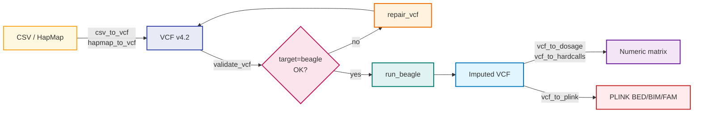

---
hide:
  - navigation
  - toc
---

<div class="beagler-hero" markdown>


# beagler

<p class="tagline">
  Genotype validation, conversion, repair, and Beagle imputation
  workflows for plant- and animal-breeding pipelines — pure R, with
  Beagle and PLINK shelled out as external tools.
</p>

[Get started :material-rocket-launch:](getting-started/installation.md){ .md-button .md-button--primary }
[GitHub :fontawesome-brands-github:](https://github.com/DidierMurilloF/beagleR){ .md-button }
[Reference :material-book-open-variant:](reference/index.md){ .md-button }

</div>

---

## Why beagler

<div class="grid cards" markdown>

-   :material-shield-check:{ .lg .middle } **Strict validation**

    ---

    `validate_genotype_table()`, `validate_marker_map()`, and
    `validate_vcf()` aggregate every issue into a single inspectable
    `beagler_result`. Programmer mistakes raise immediately; data
    issues are returned as `$errors` so callers stay in control.

-   :material-cog-transfer:{ .lg .middle } **Convert without surprises**

    ---

    `csv_to_vcf()` and `hapmap_to_vcf()` run the validators internally
    and refuse partial output. Seven encodings supported (`AHB`, `012`,
    `centered`, `AABB`, `VCF`, `REFHET`, `IUPAC`) with explicit
    REF/ALT mapping conventions.

-   :material-bandage:{ .lg .middle } **Repair, then verify**

    ---

    `repair_vcf()` runs five user-controllable steps and re-validates
    the result against `target = "beagle"` before writing. If the
    repair couldn't make it valid, no VCF lands.

-   :material-rocket-launch:{ .lg .middle } **Run Beagle safely**

    ---

    `run_beagle()` discovers Java + the Beagle JAR, builds argv as a
    vector (no shell composition), and emits a v1.0.0 JSON run record
    with SHA-256 hashes — the audit trail breeders' regulators ask for.

-   :material-chart-line:{ .lg .middle } **Benchmark imputation**

    ---

    `mask_genotypes()` + `benchmark_imputation()` +
    `compare_imputed_vs_true()` give you a reproducible accuracy
    pipeline with concordance rate, dosage R², and RMSE.

-   :material-source-branch:{ .lg .middle } **Scale by chromosome**

    ---

    `split_vcf_by_chrom()` + `run_beagle_by_chrom()` +
    `merge_beagle_outputs()` parallelize across chromosomes with
    resume logic — failed chromosome 7 doesn't re-run 1–6.

</div>

---

## 30-second tour

```r
library(beagler)

# 1. Convert breeder CSV to VCF
csv_to_vcf(
  csv = "genotypes.csv",
  marker_map = "markers.tsv",
  output_vcf = "data.vcf"
)

# 2. Validate against Beagle's requirements
v <- validate_vcf("data.vcf", target = "beagle")
if (!v$ok) repair_vcf("data.vcf", "data.clean.vcf")

# 3. Run Beagle
run <- run_beagle(
  gt = "data.clean.vcf",
  out = "imputed",
  mode = "impute",
  nthreads = 4L
)

# 4. Pull results back into R
dosage <- vcf_to_dosage("imputed.vcf.gz")
hard   <- vcf_to_hardcalls("imputed.vcf.gz", encoding = "012")
```

---

## The pipeline



---

## What's in v0.1.0

21 user-facing functions, grouped into nine areas:

| Area | Functions |
|---|---|
| Validate | `validate_genotype_table` · `validate_marker_map` · `validate_vcf` · `validate_reference_match` |
| Convert (to VCF) | `csv_to_vcf` · `hapmap_to_vcf` |
| Convert (from VCF) | `vcf_to_dosage` · `vcf_to_hardcalls` |
| Repair | `repair_vcf` |
| Run Beagle | `run_beagle` · `install_beagle` · `beagle_version` |
| Chromosome workflows | `split_vcf_by_chrom` · `run_beagle_by_chrom` · `merge_beagle_outputs` |
| PLINK bridge | `vcf_to_plink` · `plink_to_vcf` |
| Reports | `imputation_report` |
| Benchmarking | `mask_genotypes` · `compare_imputed_vs_true` · `benchmark_imputation` |

See the [Reference](reference/index.md) for full signatures or the
[Examples](examples/index.md) for end-to-end walkthroughs.
