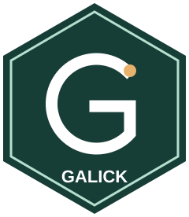
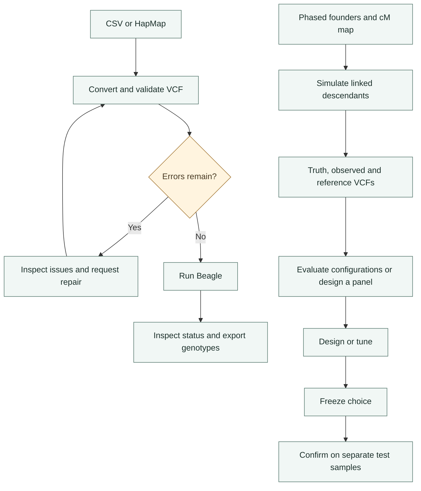

<div class="home-intro" markdown>

<div markdown>

# Galick

**VCF tools, breeding-genotype simulation and Beagle imputation in R.**

Prepare breeding genotype data for Beagle, inspect conversion losses and validate
imputation experiments. Galick adds linked-genotype simulation, held-out comparison
of Beagle configurations and constrained marker-panel design to the core VCF
workflow. It does not estimate trait effects or breeding values.

</div>



</div>

<p class="home-maintainer">
  <span>Developed and maintained by</span>
  <a href="https://www.ndsu.edu/agricultural-data-analytics">Agricultural Data Analytics at North Dakota State University</a>
</p>

[Installation](getting-started/installation.md) ·
[Quick tour](getting-started/quick-tour.md) ·
[Function reference](reference/index.md)

## Start with bundled data

No external tools are needed for this example.

```r
library(galick)

csv <- system.file("extdata", "tiny.csv", package = "galick")
map <- system.file("extdata", "tiny_map.tsv", package = "galick")
vcf <- tempfile(fileext = ".vcf")

conversion <- csv_to_vcf(csv, map, vcf, encoding = "AHB")
stopifnot(conversion$ok)
stopifnot(validate_vcf(vcf, target = "beagle")$ok)

counts <- vcf_to_dosage(vcf)
counts[1:3, 1:4]
```

The fixture has five samples and 20 markers. It illustrates software behavior,
not expected accuracy in a breeding population. `vcf_to_dosage()` reads GT allele
counts, not expected DS dosage.

## Choose a workflow

| Task | Start here |
|---|---|
| Prepare CSV or HapMap | [Conversion](reference/convert-to-vcf.md) |
| Inspect or repair a VCF | [Validation](reference/validate.md), [repair](reference/repair.md) |
| Run and inspect Beagle | [Beagle execution](examples/run-beagle.md) |
| Export or merge genotype data | [Export and merge](examples/export-and-merge.md) |
| Generate linked experimental data | [Simulation](examples/simulate-vcf.md) |
| Compare Beagle configurations | [Held-out evaluation](examples/evaluate-imputation.md) |
| Choose a lower-density SNP panel | [Panel design](examples/design-marker-panel.md) |

## Genotype imputation for plant and animal breeding

Galick connects the preparation and evaluation steps around Beagle. Convert
CSV or HapMap tables to VCF, investigate unsupported alleles and genotype
quality fields, and run reproducible diploid imputation or phasing jobs.
Keep GT allele counts distinct from expected DS dosage when exporting results.

Three experimental workflows extend that foundation:

- [Simulate linked genotypes](reference/simulation.md) from representative phased
  founders and a genetic map, with diploid crosses or restricted autotetraploid
  inheritance. Initial LD and population structure come from the founders.
- [Evaluate imputation accuracy](examples/evaluate-imputation.md) with paired
  masking or array thinning, separate tuning and test samples, and explicit
  completion, RMSE and concordance metrics.
- [Design a low-density SNP panel](reference/panel-design.md) for genotyping
  future individuals, using design-only local LD and independently tested
  Beagle recovery rather than trait-association scores.

These tools support experiment design; they do not establish biological
superiority, perform GWAS or predict breeding values.

## From data to a checked experiment

<div class="diagram" markdown>



</div>

## Understand the result

Validation, conversion and repair return `galick_result`; tool execution returns
`galick_run`. Simulation, evaluation and panel design have dedicated subclasses.
Inspect collected errors and warnings. A successful experiment can have no
recommended winner; `$ok` is not evidence of biological superiority.

See [Result classes](getting-started/result-classes.md) and the
[28-function reference](reference/index.md).

## Scope

Beagle execution, evaluation and panel design require diploid biallelic input.
The simulator also supports restricted random-bivalent autotetraploids, without
enabling polyploid imputation. Most VCF operations are in-memory. Trusted truth,
representative founders and biologically appropriate holdouts remain essential.

Version 0.1.0 is pre-release. Galick is MIT licensed; external tools retain their
own licenses. [Source code](https://github.com/NDSU-AGDA/galick) and
[issue tracking](https://github.com/NDSU-AGDA/galick/issues) are public.
