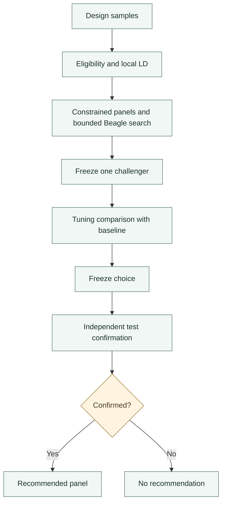

# Marker panel design

`design_marker_panel()` uses an existing densely genotyped population to choose
a smaller panel for **future** individuals. It does not save genotyping already
performed, discover trait-associated variants or manufacture an assay.

Supply trusted diploid SNP calls, a fully called phased reference with disjoint
sample IDs, and separate `design`, `tune`, `test` samples. Candidate and scoring
marker tables use exact `chrom`, `pos`, `ref`, `alt` identities and cannot overlap.

## Algorithm and constraints

1. Calculate candidate eligibility and local LD using design samples only.
2. Construct constrained baseline and informed panels of the requested size.
3. Refine proposals using actual design-stage Beagle recovery.
4. Freeze one challenger; compare it to the baseline on tuning samples.
5. Freeze the choice; confirm it on separate test samples without reranking.

Mandatory and excluded sites, chromosome quotas and minimum spacing constrain
the search. Scoring markers never enter the measured panel. All panels use the
same original-call masks within a partition. Repeats vary engine seeds, not
individuals or the panel.

Each reporting group needs at least 20 design and 10 tuning/test samples.
Declared blocks cannot cross partitions. Relatedness and renamed duplicates are
not inferred. Candidate call rate and MAF thresholds use design samples only.

## Budget and interpretation

The worst-case reservation is `(max_proposals + 6) * repeats` jobs; it must fit
`max_runs` before execution. Input-cell and local-pair ceilings are workload
limits, not memory guarantees. Restrict regions and profile before large studies.

Inspect `selection`, `metrics`, `by_group`, `search_history` and the versioned
`panel_design.json`. `recommended_panel` is `NULL` unless confirmation succeeds.
Missing predictions cannot win; absent DS never falls back to GT. Practical
improvement margins are not significance tests.

The method is a heuristic, not a proven global optimum. Confirmation applies to
the declared scoring sites and holdout design. Laboratory assay compatibility,
future-population performance and downstream trait prediction need independent
validation. For the runnable example, see [Marker panel design](../examples/design-marker-panel.md).
